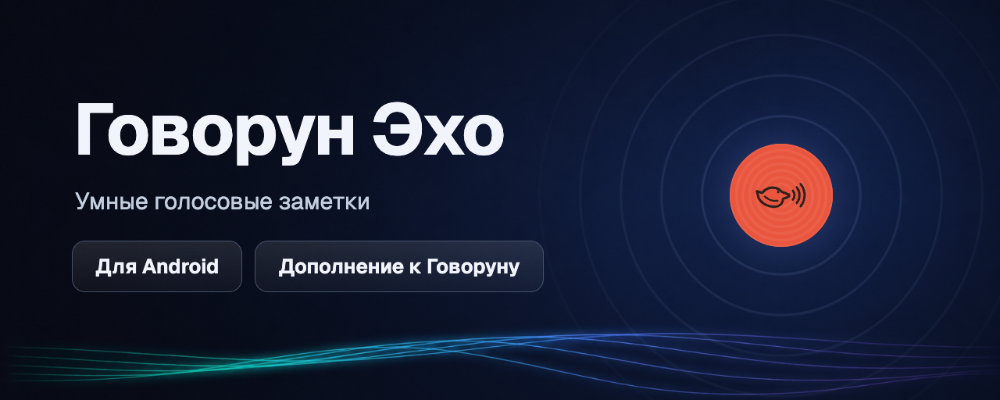
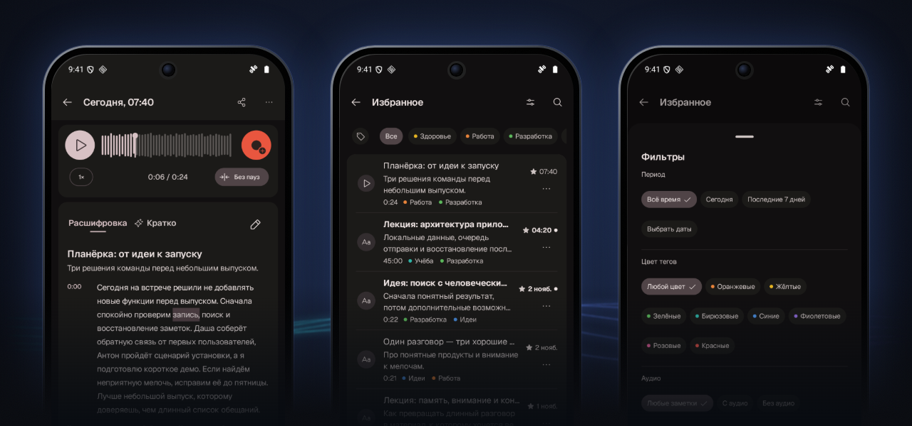
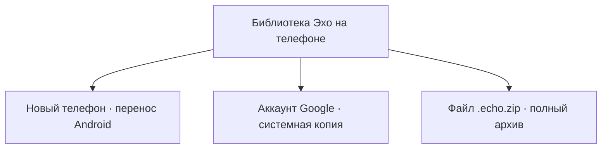
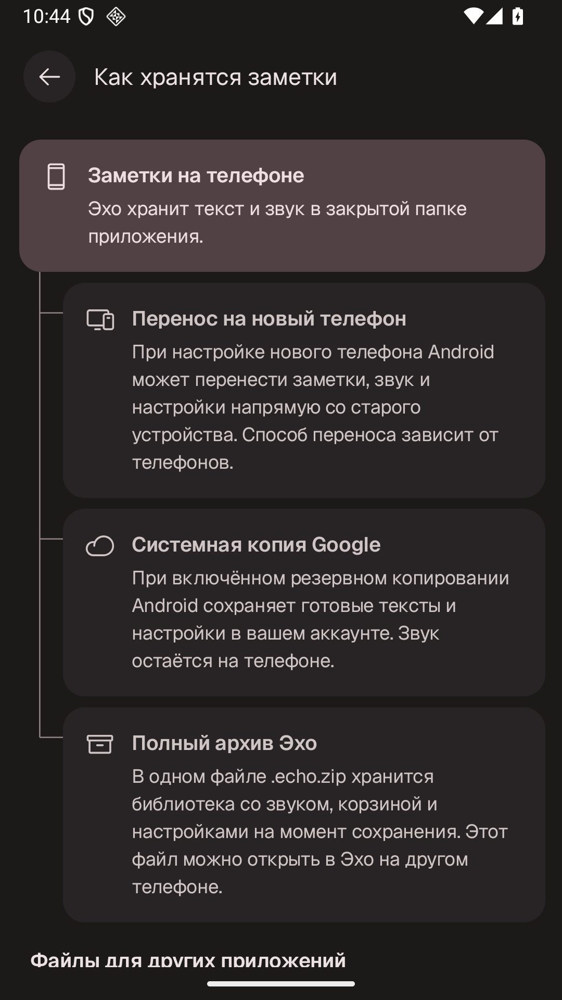
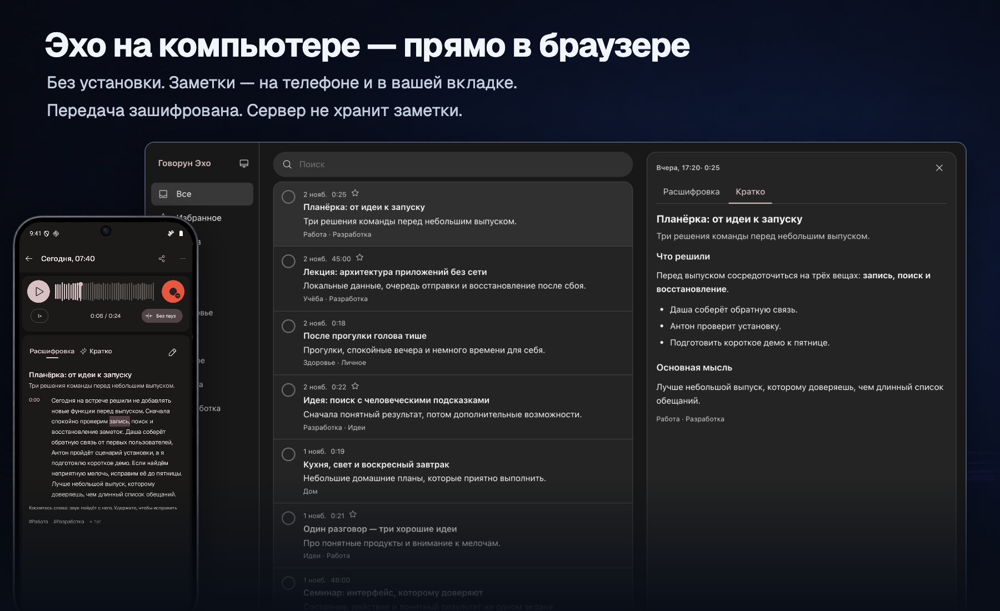
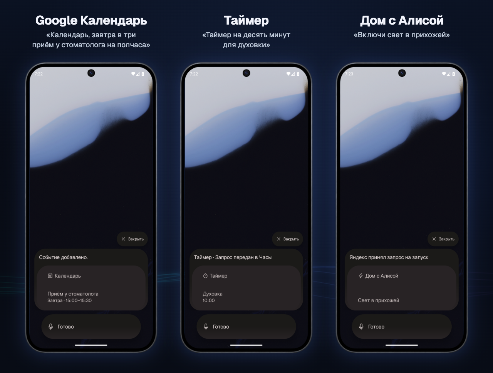
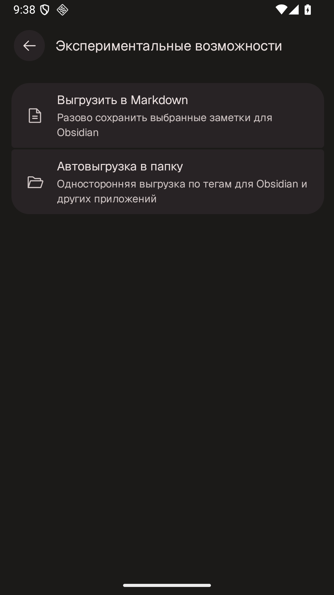
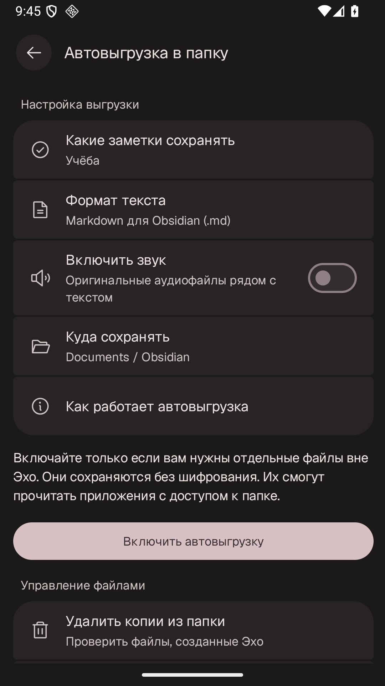

<p align="center">
  
</p>

<!-- brand-copy:start -->
**Умные голосовые заметки**
<!-- brand-copy:end -->

Эхо — голосовые заметки для пользователей [Говоруна](https://github.com/amidexe/govorun-lite). Записывайте важное, получайте текст, добавляйте теги и находите нужное поиском.

Простой интерфейс сочетается с гибкими настройками и расширяемыми интеграциями: Эхо удобно для повседневной работы с записями и можно настроить под свои задачи.

**Распознавание, хранение и поиск работают на телефоне.** У Эхо нет собственного облачного хранилища заметок. Копии, передача на компьютер и онлайн-обработка текста описаны ниже — вы управляете тем, куда передаются данные.

## Общий движок распознавания

**Говорун предоставляет общий движок распознавания через Recognition API.** Эхо и другие приложения могут использовать его вместо собственной модели. Её не нужно скачивать и загружать в память отдельно для каждого приложения — это экономит место и оперативную память телефона. Сам APK Эхо занимает около 6 МБ.

[Установить](#установка) · [Интерфейс](#удобно-каждый-день) · [Данные и копии](#данные-копии-и-экспорт) · [На компьютере](#на-компьютере) · [Голосовые команды](#голосовые-команды) · [Как устроено](#как-устроено)

<p align="center">
  
</p>

## Что умеет Эхо

- **Запись и расшифровка.** Короткие заметки и длинные лекции. Эхо может использовать микрофон телефона или гарнитуры.
- **Заметка без разблокировки.** На заблокированном телефоне удержите кнопку громкости вниз, скажите заметку и отпустите. Для настройки откройте **Настройки → Запись → Запись кнопкой громкости** и следуйте подсказкам о доступе Говоруна.
- **Слова связаны со звуком.** Нажмите на слово в расшифровке, чтобы послушать запись с этого места. Есть изменение скорости, пропуск пауз и прослушивание через верхний динамик.
- **Поиск и теги.** Поиск по словам в разных формах, числам и датам. Цветные теги, закреплённые теги над списком, избранное и архив. При открытии Эхо возвращается к выбранному тегу.
- **Работа с текстом.** Исправляйте расшифровку в отдельной вкладке «Текст», копируйте и отправляйте результат. Исходные текст и звук сохраняются.
- **Работа с записями.** Продолжение, склейка и разделение, выбор фрагмента. Звук можно удалить отдельно, оставив текст. Удалённые записи можно восстановить из корзины до её очистки.
- **Работа на телефоне.** Запись, распознавание с загруженной моделью, поиск, редактирование и прослушивание работают без сети. Режим «Офлайн» отключает сетевые функции; в роуминге они заблокированы по умолчанию.

## Удобно каждый день

- **Быстрый запуск.** Начните запись плиткой в шторке, ярлыком или виджетом. Панель записи открывается поверх текущего экрана. Её можно свернуть и продолжить запись в фоне. Для команд есть отдельный виджет.
- **Понятная навигация.** Все заметки, избранное, архив и корзина доступны из бокового меню. В меню карточки отправка текста, личные отметки и действия с записью собраны в отдельные группы.
- **Свайпы вместо лишних нажатий.** Проведите по карточке вправо, чтобы отправить её в архив, влево — в корзину. В архиве свайп вправо возвращает заметку в общий список. Случайное действие можно отменить.
- **Теги под рукой.** Закреплённые теги находятся над списком заметок. Одно нажатие открывает нужную группу, а кнопка рядом — полный список с поиском. Теги можно упорядочить, задать им цвета и короткие имена. При следующем запуске Эхо возвращается к выбранному тегу.
- **Поиск с уточнениями.** Ищите в списке заметок, внутри тега, избранного или архива. Поиск учитывает формы слов, числа и даты; фильтры помогают ограничить период, цвет тегов, наличие аудио и непрочитанные записи. Найденные слова подсвечиваются в тексте — от них можно сразу перейти к звуку.
- **Несколько заметок за один раз.** Удержите карточку, затем отметьте остальные. Добавляйте выбранные заметки в избранное, назначайте теги, архивируйте, копируйте и отправляйте вместе. Звезда находится прямо в панели выделения.
- **Светлая и тёмная темы.** Тёплая стандартная палитра или «Цвета системы» из обоев телефона; тема может меняться вместе с Android.

<p align="center">
  
</p>

## Данные, копии и экспорт

Тексты и звук хранятся на телефоне в закрытой папке Эхо. Обычные приложения Android не видят оригиналы. После разблокировки устройства приложение с полными правами root может их прочитать.

### Перенос и резервные копии



| Куда | Что туда попадает | Как это работает |
| --- | --- | --- |
| **На новый телефон** | Заметки, аудио и настройки | При настройке нового устройства выберите перенос приложений и данных со старого. Android может перенести библиотеку Эхо напрямую по кабелю или Wi-Fi. Доступные способы зависят от телефонов. Разрешения и доступ к внешней папке на новом устройстве выдаются заново. |
| **В системную копию Google** | Готовые тексты и настройки, без аудио | Если резервное копирование включено в Android и Эхо, система может восстановить эти данные из той же учётной записи. В «Хранении» видно, когда Android забирал копию и сколько заметок подготовлено сейчас. Эхо использует сквозное шифрование Android. При ограничении в 25 МБ приоритет у новых записей. |
| **В полный архив Эхо** | Библиотека со звуком, текстовыми версиями, тегами, корзиной и настройками | В **«Хранение → Сохранить и восстановить копию»** можно сохранить файл .echo.zip и открыть его в Эхо на другом телефоне. Архив отражает библиотеку на момент создания и сохраняется без пароля. Вы сами выбираете место, например компьютер или личное облако. |

<details>
<summary>Посмотреть схему на экране телефона</summary>

<p></p>

В приложении откройте **Настройки → Хранение → Как хранятся заметки**.

</details>

### Файлы для других приложений

Чтобы читать конспекты на компьютере, можно включить в экспериментальных возможностях автовыгрузку заметок с тегом «Учёба» в папку Obsidian. Эхо будет складывать туда отдельные файлы Markdown, при желании вместе со звуком. Правки в Obsidian остаются в этих файлах. Если удалить оригинал в Эхо, выгруженный конспект останется в папке. Для разовой выгрузки в TXT откройте **Настройки → Хранение → Выгрузить заметки**. [Как работать с папкой Obsidian](#работа-с-папкой-obsidian)

### Место на телефоне и удаление

В **Настройки → Хранение → Данные Эхо на телефоне** видно, сколько места занимают заметки вместе с архивом и сколько приходится на корзину, кэш и прочие данные Эхо. Файлы в папке заметок, для которых нет записи в списке, тоже учтены. Полный архив Эхо включает и их.

Из корзины заметку можно вернуть или удалить навсегда. Кнопка **«Очистить»** удаляет все заметки в корзине. Если удаление прервалось, нажмите **«Повторить удаление»**. При удалении одной заметки повтор касается только неё.

Файлами в папке автовыгрузки можно управлять из файлового менеджера. Чтобы очистить эту папку средствами Эхо, отключите автовыгрузку и нажмите **«Удалить копии из папки»**. Файлы с вашими правками сохранятся.

По умолчанию Эхо хранит заметки бессрочно. В разделе **«Заметки без тегов»** можно выбрать, когда отправлять готовую заметку без тега и звезды в архив или в корзину. Срок отсчитывается от последнего открытия, прослушивания или правки. При включении правила существующие заметки получают полный выбранный срок. Архив остаётся в поиске, а из корзины заметку можно вернуть в течение 30 дней, пока её не очистили вручную.

Команда **«Очистить хранилище»** в системных настройках Android удаляет все локальные заметки, звук, корзину и настройки Эхо. Приложение остаётся установленным. При обычном удалении приложения Android также удаляет его закрытую папку. Выгруженные файлы в «Документах» и сохранённые там ZIP остаются.

## На компьютере

<p align="center">
  
</p>

Откройте [echo.govorun.club](https://echo.govorun.club), выберите «На компьютере» в Эхо и считайте QR-код. Программа на компьютере не нужна: поиск, чтение, копирование и выгрузка работают прямо в браузере. Можно передать все заметки или выбранные теги, собрать несколько записей в один текст.

**Без входа и без облака, сервер заметок не видит.**

Вкладка создаёт пару ключей и передаёт открытый ключ телефону через QR-код. Телефон шифрует текст для этой вкладки: для согласования ключа используется ECDH, для шифрования — AES-256-GCM с проверкой целостности. HTTPS-ретранслятор передаёт зашифрованные данные, не записывает заметки на диск и не имеет ключей для их чтения. Звук остаётся на телефоне.

Локальный кеш вкладки в IndexedDB тоже зашифрован; секрет для его открытия хранится в sessionStorage и удаляется при выходе. Реализация подключения: [браузер](web/src/session.js) и [Android](app/src/main/java/com/govorun/echo/web/WebExport.kt).

## Голосовые команды

Голосом можно добавить событие в Google Календарь или другой календарь, поставить будильник или таймер и запустить сценарий «Дом с Алисой». Команды настраиваются в **Настройки → Приложение → Команды**. Через [рецепты](app/src/main/assets/recipes) можно настроить команды для Home Assistant, Telegram, Tasker и своих вебхуков.

<p align="center">
  
</p>

Шаблонам с ✨ нужны умные функции Говоруна. Для «Дома с Алисой» нужны интернет и подключение к Яндексу. Запуск с заблокированного экрана можно запретить отдельно для каждой команды.

## Умные функции и приватность

Умные функции Говоруна улучшают текст, создают «Кратко» с названием, описанием и кратким содержанием записи, а также разбирают даты, время и длительность в командах календаря, будильника и таймера. С вашего согласия Говорун отправляет на онлайн-обработку только текст. Запись, распознавание и работа с архивом доступны и при выключенных умных функциях. Для сервиса действуют подписка или промоусловия и лимиты Говоруна. Умные функции находятся в бета-версии и могут меняться или отключаться. Автоматическое «Кратко» включено по умолчанию. Его можно выключить отдельно при первом запуске или в настройках.

Сервис Говоруна использует одноразовые анонимные пропуска со слепой подписью: они подтверждают право на обработку, не раскрывая, какому аккаунту выданы. Текст передаётся без имени и данных аккаунта. Механизм и условия обработки описаны в [разделе о приватности Говоруна](https://github.com/amidexe/govorun-lite#улучшение-текста-и-приватность).

[Данные и условия Эхо](https://govorun.club/echo/legal).

## Экспериментальные возможности

В **Настройки → Приложение → О программе** пять раз нажмите **«Версия»**. Вернитесь и откройте **«Экспериментальные возможности»**.

- **Выгрузить в Markdown** — разово сохранить выбранные заметки в ZIP с файлами `.md`, например для Obsidian. При желании можно включить звук.
- **Автовыгрузка в папку** создаёт отдельные файлы для работы вне Эхо. Выбранная папка определяет, куда попадут копии. Например, выберите тег **«Учёба»**, формат **Markdown** и папку Obsidian. Эхо выгрузит готовые конспекты с этим тегом и будет добавлять новые. Если вы синхронизируете эту папку с компьютером через другое приложение, конспекты появятся и там. Можно выбрать несколько тегов или все заметки, формат TXT или Markdown, со звуком или без. Файлы сохраняются без шифрования и доступны приложениям, которым открыт доступ к папке.

<p>
  
  
</p>

### Работа с папкой Obsidian

Готовая заметка с выбранным тегом попадает во входящие как файл Markdown. В нём будут расшифровка и, если они сохранены в Эхо, «Текст» и «Кратко». При включённом звуке аудиофайлы лежат рядом. Чтобы увидеть их на компьютере, настройте синхронизацию самого хранилища, включая аудиовложения, если они нужны.

Если собираетесь переименовать конспект или переместить его из входящих в постоянную папку, **сначала снимите с заметки в Эхо тег выгрузки**. Снятие тега оставляет прежнюю копию на месте. Если подходит ещё один выбранный тег или выбрана выгрузка всех заметок, Эхо продолжит выгрузку. Учитывайте это и при перемещении связанных аудиофайлов.

**Что происходит с файлами в папке**

- После дозаписи и обработки Эхо обновит прежний Markdown, если он по-прежнему находится во входящих и не менялся извне. Правки в Obsidian сохраняются только в Obsidian. Когда меняются обе версии, Эхо сохраняет обе отдельно и сообщает о расхождении в настройках автовыгрузки. Свежую версию из Эхо можно взять через разовую выгрузку в Markdown.
- Если снять тег, удалить заметку или очистить корзину Эхо, уже выгруженный файл останется в папке. Если переименовать, переместить или удалить файл во входящих, Эхо снова создаст его под прежним именем при следующей выгрузке, пока заметка подходит под выбранные теги.
- Чтобы очистить папку от копий Эхо, сначала выключите автовыгрузку, затем нажмите **«Удалить копии из папки»**. Эхо удалит только свои копии, содержимое которых удалось подтвердить. Файлы с вашими изменениями и посторонние файлы останутся.

После обновления ранее подключённая папка остаётся на месте, а автовыгрузку нужно включить заново. Если в папке есть старый `echo-notes.json`, его можно удалить целиком отдельной галочкой при очистке. Новая выгрузка сохраняет каждую заметку отдельным файлом.

## Установка

Нужны **Android 12+**, устройство **ARM64** и **Говорун 2.1.1 или новее для Android**.

1. Установите [Говорун 2.1.1 или новее для Android](https://github.com/amidexe/govorun-lite/releases/tag/v2.1.1). Модель распознавания уже встроена; проходить настройку Говоруна перед первым запуском Эхо необязательно. Версия Говоруна для Windows или macOS не подходит.
2. Скачайте APK Эхо из [Releases](https://github.com/amidexe/govorun-echo/releases) и установите на телефон.
3. Разрешите микрофон в Эхо и подтвердите доступ к распознаванию в Говоруне.

Откройте Эхо и следуйте подсказкам первого запуска. Микрофон нужен для записи,
уведомления — для управления текущей записью и воспроизведением. Камера запрашивается
только при подключении компьютера по QR-коду. Для обычной записи специальные
возможности не нужны. Необязательный запуск кнопкой громкости настраивается через
Говорун с отдельным разрешением.

Номер установленной версии виден в «О программе». Для обновления с GitHub
установите новый APK поверх текущей версии. Если установили Эхо из RuStore,
обновляйте его через магазин.


## Совместимость и обратная связь

**Пока Эхо проверено только на Google Pixel 10 с Android 16. Нужны отзывы о работе на других телефонах.** Если всё работает — тоже напишите: это поможет понять совместимость.

Особенно интересуют запись при выключенном экране, работа в фоне и распознавание через Говорун. На других моделях эти сценарии пока не подтверждены.

Если возникла проблема, создайте [сообщение в Issues](https://github.com/amidexe/govorun-echo/issues): укажите модель телефона, версию Android, версии Эхо и Говоруна, что вы делали и что произошло. Личные записи и расшифровки прикладывать не нужно.

## Как устроено

### Распознавание через API Говоруна

Эхо записывает звук и подключается к сервису `com.govorun.api.RECOGNITION_SERVICE` в приложении `com.govorun.lite`. Контракт — [AIDL Recognition API v1](app/src/main/aidl/com/govorun/api/v1), транспорт — локальный Android Binder. Перед подключением проверяется подпись установленного Говоруна; доступ подтверждает пользователь. Интернет и аккаунт для распознавания не нужны.

О модели распознавания и движке на телефоне — в [техническом описании Говоруна](https://github.com/amidexe/govorun-lite#как-устроен-код). Для интеграции других приложений есть [описание Recognition API](https://github.com/amidexe/govorun-lite#recognition-api).

Для распознавания используется PCM: 16 кГц, моно, 16 бит. Длинную запись Говорун читает постепенно и возвращает текст фраза за фразой, со временем каждого слова. Эти отметки связывают расшифровку со звуком.

Запись и очередь обработки разделены: готовый звук остаётся на диске, пока ожидается распознавание. Длинные файлы обрабатываются в фоне, очередь можно приостановить и продолжить.

### Хранение и компоненты

Заметки — файлы со звуком, текстом и метаданными. SQLite хранит только поисковый индекс: при повреждении его можно построить заново из файлов заметок.

| Задача | Технологии и зачем они здесь |
| --- | --- |
| Android-интерфейс | Kotlin, Jetpack Compose и Material 3; фоновые операции — Kotlin Coroutines |
| Запись и воспроизведение | Ogg/Opus через системный MediaCodec, проигрыватель — AndroidX Media3. Звук пишется на диск по мере записи, без финальной перекодировки |
| Поиск | SQLite FTS4, русский стемминг по алгоритму Snowball и ранжирование BM25: поиск учитывает формы слов и поднимает более подходящие записи |
| Браузер | Svelte 5 и Vite; Markdown отображает markdown-it, шифрование выполняет встроенный Web Crypto API |
| QR-код | CameraX и ZXing: телефон считывает код локально, без Google Play Services |
| Ретранслятор | Go и стандартный `net/http`, без внешних Go-зависимостей и базы заметок |

### Исходники

| Каталог | Назначение |
| --- | --- |
| [app](app) | Android-приложение: запись, API Говоруна, заметки, поиск, проигрыватель и копии |
| [clip](clip) | Экспорт видео с субтитрами |
| [smart](smart) | Общие типы и обработка умных операций |
| [web](web) | Браузерный клиент |
| [relay](relay) | Передача зашифрованных данных между телефоном и браузером |

### Сборка

**Android:** JDK 17+, Android SDK 36.

```sh
./gradlew :app:assembleRelease
```

APK находится по пути `app/build/outputs/apk/release/app-release-unsigned.apk`. Для установки подпишите сборку своим ключом.

**Браузер:** Node.js и npm, команды из каталога `web`.

```sh
npm ci
npm run build
```

**Ретранслятор:** Go, команда из каталога `relay`.

```sh
go build .
```

## Лицензия

Код — [GPL-3.0-or-later](LICENSE). Название и значки — по условиям [BRAND_NOTICE.txt](BRAND_NOTICE.txt). Лицензии сторонних компонентов находятся в [app/src/main/assets/licenses.txt](app/src/main/assets/licenses.txt).
