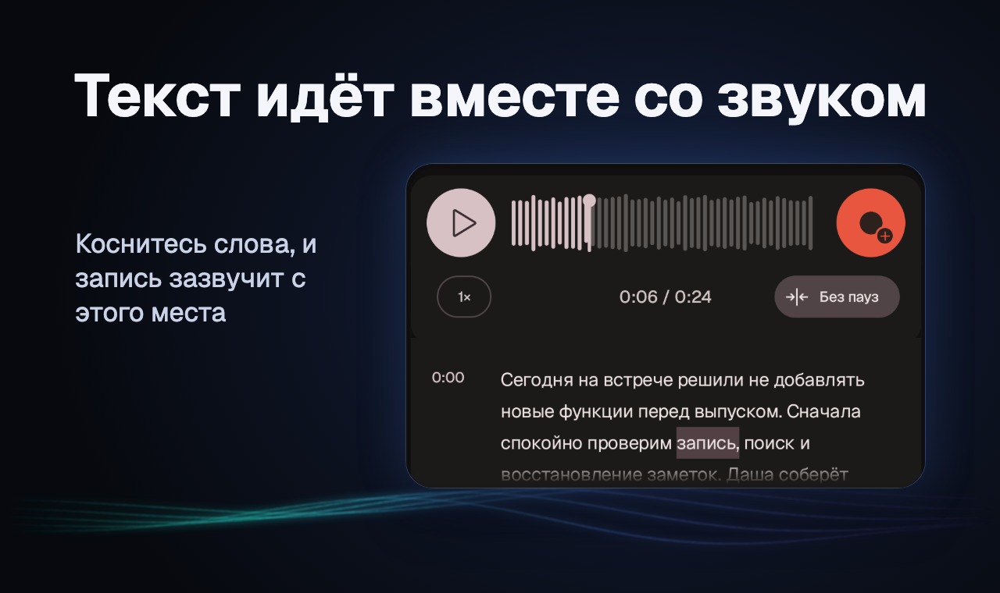

<p align="center">
  
</p>

<!-- brand-copy:start -->
**Умные голосовые заметки**
<!-- brand-copy:end -->

Эхо — голосовые заметки для пользователей [Говоруна](https://github.com/amidexe/govorun-lite). Записывайте важное, получайте текст, добавляйте теги и находите нужное поиском.

Простой интерфейс сочетается с гибкими настройками и расширяемыми интеграциями: Эхо удобно для повседневной работы с записями и можно настроить под свои задачи.

**Распознавание, хранение и поиск работают на телефоне.** У Эхо нет собственного облачного хранилища заметок. Копии, передача на компьютер и онлайн-обработка текста описаны ниже — вы управляете тем, куда передаются данные.

## Общий движок распознавания

**Говорун предоставляет общий движок распознавания через Recognition API.** Эхо и другие приложения могут использовать его вместо собственной модели. Её не нужно скачивать и загружать в память отдельно для каждого приложения — это экономит место и оперативную память телефона. Сам APK Эхо занимает около 6 МБ.

[Установить](#установка) · [Интерфейс](#удобно-каждый-день) · [Данные и копии](#данные-копии-и-экспорт) · [На компьютере](#на-компьютере) · [Как устроено](#как-устроено)

<p align="center">
  
</p>

## Что умеет Эхо

- **Запись и расшифровка.** Короткие заметки и длинные лекции. Быстрый запуск плиткой в шторке; микрофон телефона или гарнитуры.
- **Заметка без разблокировки.** На заблокированном телефоне удержите кнопку громкости вниз, скажите заметку и отпустите — запись сохранится. Открывать приложение не нужно. Включается в настройках Эхо.
- **Слова связаны со звуком.** Нажмите на слово в расшифровке, чтобы послушать запись с этого места. Есть изменение скорости, пропуск пауз и прослушивание через верхний динамик.
- **Поиск и теги.** Поиск по словам в разных формах, числам и датам. Цветные теги, закреплённые теги над списком, избранное и архив. При открытии Эхо возвращается к выбранному тегу.
- **Работа с текстом.** Исправляйте расшифровку в отдельной вкладке «Текст», копируйте и отправляйте результат. Исходные текст и звук сохраняются.
- **Работа с записями.** Продолжение, склейка и разделение, выбор фрагмента. Звук можно удалить отдельно, оставив текст. Удалённые записи можно восстановить из корзины до её очистки.
- **Работа на телефоне.** Запись, распознавание с загруженной моделью, поиск, редактирование и прослушивание работают без сети. Режим «Офлайн» отключает сетевые функции; в роуминге они заблокированы по умолчанию.

## Удобно каждый день

- **Понятная навигация.** Все заметки, избранное, архив и корзина доступны из бокового меню. В меню карточки отправка текста, личные отметки и действия с записью собраны в отдельные группы.
- **Свайпы вместо лишних нажатий.** Проведите по карточке вправо, чтобы отправить её в архив, влево — в корзину. В архиве свайп вправо возвращает заметку в общий список. Случайное действие можно отменить.
- **Теги под рукой.** Закреплённые теги находятся над списком заметок. Одно нажатие открывает нужную группу, а кнопка рядом — полный список с поиском. Теги можно упорядочить, задать им цвета и короткие имена. При следующем запуске Эхо возвращается к выбранному тегу.
- **Поиск с уточнениями.** Ищите в списке заметок, внутри тега, избранного или архива. Поиск учитывает формы слов, числа и даты; фильтры помогают ограничить период, цвет тегов, наличие аудио и непрочитанные записи. Найденные слова подсвечиваются в тексте — от них можно сразу перейти к звуку.
- **Несколько заметок за один раз.** Удержите карточку, затем отметьте остальные. Добавляйте выбранные заметки в избранное, назначайте теги, архивируйте, копируйте и отправляйте вместе. Звезда находится прямо в панели выделения.
- **Светлая и тёмная темы.** Тёплая стандартная палитра или «Цвета системы» из обоев телефона; тема может меняться вместе с Android.

<p align="center">
  
</p>

## Данные, копии и экспорт

Копии помогают восстановить записи и переехать на другой телефон, а открытые форматы — работать с данными за пределами Эхо.

- **Папка для копий.** Новые и изменённые заметки сохраняются вместе со звуком в выбранную папку — на телефоне или в подключённом хранилище. Из неё можно восстановить записи в Эхо.
- **Google.** Тексты и данные заметок сохраняются через резервное копирование Android, если оно включено на телефоне и в Эхо. Аудиозаписи в копию не входят. Эхо разрешает облачную копию только при сквозном шифровании Android, связанном с PIN-кодом, паролем или графическим ключом блокировки экрана. Лимит — 25 МБ, с приоритетом новых заметок; состояние копии видно в настройках. Выключение этой копии не отключает прямой перенос между телефонами.
- **Переезд средствами Android.** При прямом переносе на новый телефон передаются записи со звуком, текстовые версии, черновики, корзина и пользовательские настройки. Секреты, разрешения и подключения устройства не переносятся. Доступность переноса по кабелю или Wi-Fi зависит от Android и производителя телефона; Google-сервисы самому Эхо не требуются.
- **Полный перенос `.echo.zip`.** Записи со звуком, все текстовые версии, теги, избранное, корзина и настройки — для восстановления или переезда на другой телефон. Файл копии не зашифрован: сохраняйте его в защищённом месте.
- **Импорт и экспорт.** Эхо принимает аудио и видео из файлов и через «Поделиться». Выгрузка — текст, Markdown, звук Ogg/Opus, субтитры SRT или видео с текстом. Эти файлы открываются и без Эхо.

## На компьютере

<p align="center">
  
</p>

Откройте [echo.govorun.club](https://echo.govorun.club), выберите «На компьютере» в Эхо и считайте QR-код. Программа на компьютере не нужна: поиск, чтение, копирование и выгрузка работают прямо в браузере. Можно передать все заметки или выбранные теги, собрать несколько записей в один текст.

**Без входа и без облака, сервер заметок не видит.**

Вкладка создаёт пару ключей и передаёт открытый ключ телефону через QR-код. Телефон шифрует текст для этой вкладки: для согласования ключа используется ECDH, для шифрования — AES-256-GCM с проверкой целостности. HTTPS-ретранслятор передаёт зашифрованные данные, не записывает заметки на диск и не имеет ключей для их чтения. Звук остаётся на телефоне.

Локальный кеш вкладки в IndexedDB тоже зашифрован; секрет для его открытия хранится в sessionStorage и удаляется при выходе. Реализация подключения: [браузер](web/src/session.js) и [Android](app/src/main/java/com/govorun/echo/web/WebExport.kt).

## Умные функции и приватность

Через Говорун можно улучшить текст и получить «Кратко» — название, описание и краткое содержание записи. Это необязательные онлайн-функции: с вашего согласия передаётся текст, без аудио. Для сервиса действуют подписка или промоусловия и лимиты Говоруна. Запись, распознавание и работа со своим архивом от умных функций не зависят. Умные функции находятся в бета-версии и могут меняться или отключаться. Автоматическое «Кратко» включено по умолчанию; его можно выключить при первом запуске или в настройках для экономии.

Сервис Говоруна использует одноразовые анонимные пропуска со слепой подписью: они подтверждают право на обработку, не раскрывая, какому аккаунту выданы. Текст передаётся без имени и данных аккаунта. Механизм и условия обработки описаны в [разделе о приватности Говоруна](https://github.com/amidexe/govorun-lite#улучшение-текста-и-приватность).

[Данные и условия Эхо](https://govorun.club/echo/legal).

## Экспериментальные возможности

Откройте **Настройки → Приложение → О программе** и пять раз нажмите строку **«Версия»** внизу экрана. Вернитесь на вкладку **«Приложение»** — там появится раздел **«Экспериментальное»**:

- **Markdown для Obsidian.** Эхо автоматически сохраняет `.md`-файлы с текстом, тегами и ссылками на звук в выбранную папку на телефоне. Идея — забирать их в хранилище Obsidian и использовать привычный способ переноса или синхронизации. Связка с Obsidian ещё требует проверки на практике; будем рады опыту его пользователей.
- **Голосовые команды.** Задайте фразу и действие: отправить текст через Telegram-бота, включить свет в Home Assistant или передать команду Tasker. Эхо выполняет HTTP-запрос или отправляет Android Intent после распознавания. Свои API, вебхуки и цепочки автоматизации подключаются через [JSON-рецепты](app/src/main/assets/recipes), которые можно добавлять в приложение и копировать для обмена. Адрес сервиса выбираете вы; при использовании `http://` запрос не защищён TLS.

## Установка

Нужны **Android 12+**, устройство **ARM64** и **Говорун 2.1.1 или новее для Android**.

1. Установите [Говорун 2.1.1 или новее для Android](https://github.com/amidexe/govorun-lite/releases/tag/v2.1.1). Модель распознавания уже встроена; проходить настройку Говоруна перед первым запуском Эхо необязательно. Версия Говоруна для Windows или macOS не подходит.
2. Скачайте APK Эхо из [Releases](https://github.com/amidexe/govorun-echo/releases) и установите на телефон.
3. Разрешите микрофон в Эхо и подтвердите доступ к распознаванию в Говоруне.

Откройте Эхо и следуйте подсказкам первого запуска. Микрофон нужен для записи,
уведомления — для управления текущей записью и воспроизведением. Камера запрашивается
только при подключении компьютера по QR-коду. Для обычной записи специальные
возможности не нужны. Необязательный запуск кнопкой громкости настраивается через
Говорун с отдельным разрешением.

Выпуск для GitHub и RuStore содержит один и тот же набор возможностей, включая
умные функции через Говорун. Встроенного канала обновлений в этом APK нет:
номер версии виден в «О программе», обновления с GitHub устанавливаются новым APK,
а при установке из RuStore — средствами магазина.


## Совместимость и обратная связь

**Пока Эхо проверено только на Google Pixel 10 с Android 16. Нужны отзывы о работе на других телефонах.** Если всё работает — тоже напишите: это поможет понять совместимость.

Особенно интересуют запись при выключенном экране, работа в фоне и распознавание через Говорун. На других моделях эти сценарии пока не подтверждены.

Если возникла проблема, создайте [сообщение в Issues](https://github.com/amidexe/govorun-echo/issues): укажите модель телефона, версию Android, версии Эхо и Говоруна, что вы делали и что произошло. Личные записи и расшифровки прикладывать не нужно.

## Как устроено

### Распознавание через API Говоруна

Эхо записывает звук и подключается к сервису `com.govorun.api.RECOGNITION_SERVICE` в приложении `com.govorun.lite`. Контракт — [AIDL Recognition API v1](app/src/main/aidl/com/govorun/api/v1), транспорт — локальный Android Binder. Перед подключением проверяется подпись установленного Говоруна; доступ подтверждает пользователь. Интернет и аккаунт для распознавания не нужны.

О модели распознавания и движке на телефоне — в [техническом описании Говоруна](https://github.com/amidexe/govorun-lite#как-устроен-код). Для интеграции других приложений есть [описание Recognition API](https://github.com/amidexe/govorun-lite#recognition-api).

Для распознавания используется PCM: 16 кГц, моно, 16 бит. Длинную запись Говорун читает постепенно и возвращает текст фраза за фразой, со временем каждого слова. Эти отметки связывают расшифровку со звуком.

Запись и очередь обработки разделены: готовый звук остаётся на диске, пока ожидается распознавание. Длинные файлы обрабатываются в фоне, очередь можно приостановить и продолжить.

### Хранение и компоненты

Заметки — файлы со звуком, текстом и метаданными. SQLite хранит только поисковый индекс: при повреждении его можно построить заново из файлов заметок.

| Задача | Технологии и зачем они здесь |
| --- | --- |
| Android-интерфейс | Kotlin, Jetpack Compose и Material 3; фоновые операции — Kotlin Coroutines |
| Запись и воспроизведение | Ogg/Opus через системный MediaCodec, проигрыватель — AndroidX Media3. Звук пишется на диск по мере записи, без финальной перекодировки |
| Поиск | SQLite FTS4, русский стемминг по алгоритму Snowball и ранжирование BM25: поиск учитывает формы слов и поднимает более подходящие записи |
| Браузер | Svelte 5 и Vite; Markdown отображает markdown-it, шифрование выполняет встроенный Web Crypto API |
| QR-код | CameraX и ZXing: телефон считывает код локально, без Google Play Services |
| Ретранслятор | Go и стандартный `net/http`, без внешних Go-зависимостей и базы заметок |

### Исходники

| Каталог | Назначение |
| --- | --- |
| [app](app) | Android-приложение: запись, API Говоруна, заметки, поиск, проигрыватель и копии |
| [clip](clip) | Экспорт видео с субтитрами |
| [smart](smart) | Общие типы и обработка умных операций |
| [web](web) | Браузерный клиент |
| [relay](relay) | Передача зашифрованных данных между телефоном и браузером |

### Сборка

**Android:** JDK 17+, Android SDK 36.

```sh
./gradlew :app:assembleRelease
```

APK: `app/build/outputs/apk/release/app-release-unsigned.apk`. Это единая выпускная конфигурация для GitHub и RuStore: умные функции включены, встроенного канала обновлений и отдельной службы спецвозможностей Эхо нет. Для установки подпишите сборку своим ключом.

**Браузер:** Node.js и npm, команды из каталога `web`.

```sh
npm ci
npm run build
```

**Ретранслятор:** Go, команда из каталога `relay`.

```sh
go build .
```

## Лицензия

Код — [GPL-3.0-or-later](LICENSE). Название и значки — по условиям [BRAND_NOTICE.txt](BRAND_NOTICE.txt). Лицензии сторонних компонентов находятся в [app/src/main/assets/licenses.txt](app/src/main/assets/licenses.txt).
